<!-- Variant: FLASHY. To use it, rename this file to README.md -->

  
  
  
  

## ⚡ The short version

- 🧠 **Full-stack product builder.** I handle idea, UX, UI, frontend, backend, data, launch and support. No agency, no hand-offs.
- 🏙️ **Baku-made, world-ready.** My software runs in Azerbaijani, English and Russian.
- 📡 **Big-network energy.** Metro Run pays players in **Azercell**, **Bakcell** and **Nar** mobile credit.
- 🏢 **Enterprise-proven.** SeaBreeze FMS runs the canteens of a company with **3,000+ employees**.
- 🎮 **60 fps or it doesn't ship.** Skia game engines, Roblox sims, real-time floor plans.
- 🤖 **AI that actually ships.** Whisper + OpenCV pipelines, plus AI agents inside my apps.

## 🛠️ Arsenal

 
 
 

  

**🧪 Testing, every layer** 

## 🚀 Shipped

<table>
<tr>
<td width="33%" valign="top" align="center">
<h3>🚇 <a href="https://metrorun-az.vercel.app/">Metro Run</a></h3>
Endless runner in the Baku metro. Scores become <b>Azercell / Bakcell / Nar</b> credit. Offline-first, server-verified.  
<code>Expo</code> <code>Skia</code> <code>Supabase</code>
</td>
<td width="33%" valign="top" align="center">
<h3>🏢 SeaBreeze FMS</h3>
Canteen OS for <b>3,000+ employees</b>: menus, cycles, HR approvals, finance.  
<code>React</code> <code>Supabase</code> <code>Tailwind</code>
</td>
<td width="33%" valign="top" align="center">
<h3>🧾 <a href="https://mybill-phi.vercel.app/">My Bill</a></h3>
Scan, split, pay. Restaurant bills without the wait.  
<code>Fintech</code> <code>Web</code>
</td>
</tr>
<tr>
<td valign="top" align="center">
<h3>🍽️ Buta</h3>
Redrawable floor plan, live tables, deposits, audit log.  
<code>React</code> <code>Vite</code> <code>Supabase</code>
</td>
<td valign="top" align="center">
<h3>💈 Zapp</h3>
Self-booking for salons &amp; clinics, with WhatsApp/SMS reminders.  
<code>Next.js</code> <code>Postgres</code> <code>Capacitor</code>
</td>
<td valign="top" align="center">
<h3>🎬 ClipperAgent</h3>
Long video in, viral-ranked 9:16 captioned clips out. 100% local AI.  
<code>Python</code> <code>Whisper</code> <code>OpenCV</code>
</td>
</tr>
<tr>
<td valign="top" align="center">
<h3>🦻 KIND Hearing</h3>
Clinic site: 185 hearing aids, free tests, monthly plans.  
<code>HTML</code> <code>CSS</code> <code>Docker</code>
</td>
<td valign="top" align="center">
<h3>🏎️ GT Competizione</h3>
Roblox GT racing sim with pit stops and car setups.  
<code>Roblox</code> <code>Luau</code>
</td>
<td valign="top" align="center">
<h3>🪟 Dynamic Island</h3>
macOS-style Dynamic Island for Windows. Plus Daybase &amp; Household apps.  
<code>Desktop</code> <code>Mobile</code>
</td>
</tr>
</table>

## 📊 Numbers

<picture>
  <source media="(prefers-color-scheme: dark)" srcset="https://raw.githubusercontent.com/karimliabdullah/karimliabdullah/output/github-snake-dark.svg" />
  
</picture>

### 💬 Got an idea? Let's make it real.

