<!-- Variant: TERMINAL. Alternatives: README-premium.md, README-flashy.md -->

<div align="center">



<br />

<a href="https://abdullahkarimli.vercel.app/">
  
</a>

<p>
  <a href="https://abdullahkarimli.vercel.app/"></a>
  <a href="https://abdullahkarimli.vercel.app/book"></a>
  
</p>

</div>

```console
abdullah@baku:~$ cat about.txt
```

> I don't hand off. I take a product from **the first call → prototype → design → frontend → backend → launch → the fixes after**.
> Clinics, restaurants, salons, a 3,000-employee company, fintech and games: if it runs on a screen, I ship it, in **Azerbaijani, Turkish, English, Russian, Arabic, French and Chinese**.

```console
abdullah@baku:~$ ls -la ~/shipped
```

| `drwx` | Project | What it does | Stack |
|:--:|---|---|---|
| 🚇 | **[Metro Run](https://metrorun-az.vercel.app/)** | Endless runner set in the Baku metro. Points turn into **Azercell, Bakcell & Nar** mobile credit. Plays offline in the tunnel; every score is replayed server-side before payout. | `Expo` `Skia` `Supabase` `Edge Functions` |
| 🧾 | **[My Bill](https://mybill-phi.vercel.app/)** | Restaurant fintech: scan a QR, see the bill, split it, pay. No waiting for the waiter. | `Product design` `Web` |
| 🍽️ | **Buta Reservation** | Full restaurant system: a redrawable floor plan, live table status, deposits, roles and an audit log of every change. | `React` `Vite` `Supabase` |
| 💈 | **Zapp** | Booking platform for salons, barbers and clinics, with WhatsApp/SMS reminders and no-show deposits. | `Next.js` `Postgres` `Capacitor` |
| 🏢 | **SeaBreeze FMS** | Canteen management for **3,000+ employees**: menus, meal cycles, HR approvals, finance reports. | `React` `Supabase` `Tailwind` |
| 🦻 | **KIND Hearing Center** | Clinic website with 185 hearing aids, free hearing tests and monthly payment plans. | `HTML` `CSS` `Docker` |
| 🎬 | **ClipperAgent** | Local AI that cuts long videos into ranked, captioned 9:16 clips. | `Python` `Whisper` `OpenCV` `FFmpeg` |
| 🏎️ | **GT Competizione** | GT racing sim on Roblox: full circuit, pit stops, car setups. | `Roblox` `Luau` |
| 📱 | **Daybase · Household** | AI-powered tasks app · live-synced household chores. | `React Native` `Supabase` |
| 🪟 | **Dynamic Island for Windows** | macOS-style Dynamic Island on the Windows desktop. | `Desktop` |

```console
abdullah@baku:~$ grep -ri "brand" ~/shipped --count
```

<div align="center">

**Azercell** · **Bakcell** · **Nar**: all three Azerbaijani carriers are wired into Metro Run's reward payouts<br/>
**Healthcare** · **Hospitality** · **Fintech** · **Beauty & wellness** · **Enterprise HR** · **Gaming** · **AI**

</div>

```console
abdullah@baku:~$ tree ~/stack -L 1
```

<details open>
<summary><b>~/stack/frontend</b></summary>
<br/>

</details>

<details open>
<summary><b>~/stack/mobile+games</b></summary>
<br/>

<br/>


</details>

<details open>
<summary><b>~/stack/backend+data</b></summary>
<br/>

</details>

<details open>
<summary><b>~/stack/languages</b></summary>
<br/>

</details>

<details open>
<summary><b>~/stack/ai+media</b></summary>
<br/>

<br/>


</details>

<details open>
<summary><b>~/stack/ship+ops</b></summary>
<br/>

</details>

```console
abdullah@baku:~$ npm run test:everything
```

```diff
+ ✓ unit + integration ........ Jest · Vitest
+ ✓ end-to-end ................ Playwright · Cypress · Selenium
+ ✓ API + contracts ........... Postman · schema validation
+ ✓ load + performance ........ k6 · Lighthouse
+ ✓ accessibility ............. axe · keyboard · screen readers
+ ✓ anti-cheat ................ every Metro Run score replayed server-side
+ ✓ real users ................ launched, watched, fixed

  7 passing · 0 failing · shipped to production
```

```console
abdullah@baku:~$ gh stats --me
```

<div align="center">


</div>

```console
abdullah@baku:~$ ./book-a-call.sh
```

<div align="center">

**Got a product in your head? I'll get it on a screen.**

[](https://abdullahkarimli.vercel.app/book)

<sub>Client work stays private, so most of what I build lives in private repos.</sub>

</div>
